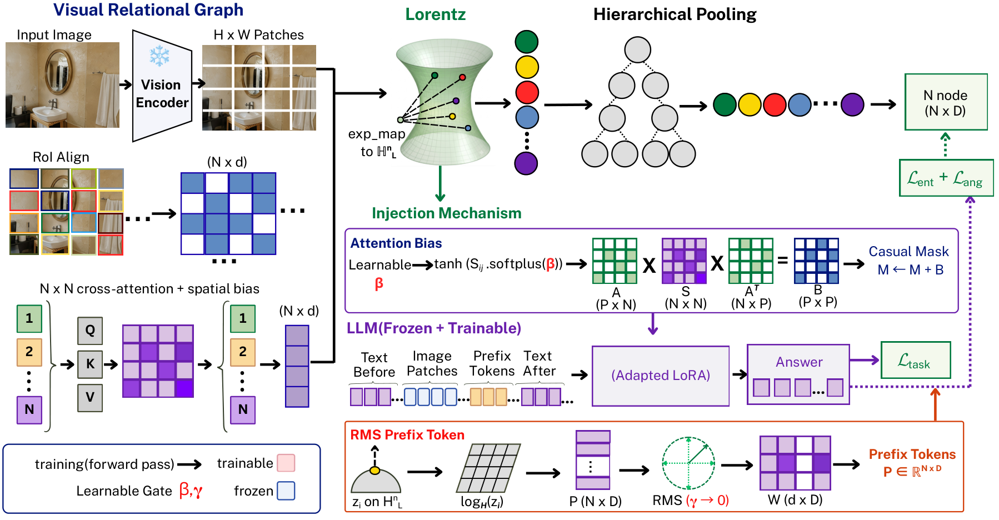

# The Gate Always Closes: On Injecting Auxiliary Signals into Frozen Vision-Language Models

Moshiur Farazi, Sameera Ramasinghe, Bekir Sait Ciftler, Mahbub Ahmed Turza, Shafin Rahman.
ACCV 2026. arXiv: [2607.23335](https://arxiv.org/abs/2607.23335).
Code: <https://github.com/mrfarazi/the-gate-always-closes>. Licence: MIT.

<p align="center">
  
</p>

This repository contains the code, the result files and the checkpoint registry behind the
paper: the training code for every LLaVA-1.5-7B configuration and the InternVL3-8B and Qwen2-VL-7B ports, the
evaluators, the knock-out and probe scripts, the per-question result JSONs, and a table generator
that rebuilds the 12 generated tables of the paper and supplement, plus one protocol check, from those JSONs.

## Abstract

> Auxiliary signal pathways in VLMs are routinely fitted with learnable gates so the optimiser can decide how much of the signal to admit. We study what the optimiser decides, and whether the model then uses the signal, with hyperbolic visual relational graphs as the experimental vehicle. We find that under cross-entropy fine-tuning the optimiser decides on zero: the gate closes in every design we trained, across five injection designs on LLaVA-1.5-7B, 15 of 15 runs on Qwen2-VL-7B spanning four task families, 3 of 3 seeds on InternVL3-8B, and with LoRA on all linear layers. We attribute this suppression phenomenon to two regimes, a dead-gradient regime formalised through the caption-invariance of image-derived signals and measured directly, and a negative-utility regime in which the auxiliary signal actively hurts the loss. A closed gate does not by itself mean an inert pathway, so we ablate each pathway at inference under one protocol with real region proposals: the norm-aligned designs are behaviourally closed (at most 1.5pp change at the learned gate), whereas the un-normalised gated prefix is open and harmful, costing 6.7pp on relational GQA at its learned gate of +0.005 while helping SugarCrepe. Evaluating every configuration under one inference mode shows that an active injected pathway costs up to 15pp on relational GQA and 7-12pp on out-of-distribution VSR, that the geometric training losses give no measurable in-distribution gain once the pathway is dropped, and that a Euclidean containment control ties the hyperbolic one. Embedding-norm alignment remains necessary for prefix injection that preserves generation. We recommend testing signal use by ablation rather than by reading gate values or attention mass.

## Headline numbers

All numbers below are in [RESULTS.md](RESULTS.md), with per-number provenance in
[results/NUMBERS.md](results/NUMBERS.md). Table numbers refer to the paper (main) and supplement (S).

- The gate closes in every design trained: five injection designs on LLaVA-1.5-7B, 15 of 15 runs
  on Qwen2-VL-7B (all |tanh gamma| <= 0.018), 3 of 3 seeds on InternVL3-8B
  (tanh gamma = +0.006 / -0.001 / -0.004), and with LoRA on all seven linear projections
  (+0.024 / -0.030) (Table 1).
- Knocked out with 6x6 grid proposals, the norm-aligned designs are behaviourally closed: at most
  1.5pp change at the learned gate on GQA-rel and SugarCrepe (Tables 3, S2).
- S5, the raw gated prefix, is open and harmful: at its learned gate tanh gamma = +0.005 it costs
  6.7pp [-8.4, -5.0] on GQA-rel (n = 1,000) and gains 1.5pp [+0.7, +2.4] on SugarCrepe; forced
  fully open (gamma = 1) it costs 38.5pp (Tables 3, S3).
- Under one inference mode, an active prefix pathway costs up to 15.5pp on GQA-rel (RMS prefix,
  published checkpoint: 53.41 dropped vs 37.92 active) and 6.9-12.3pp on VSR; with the pathway
  dropped, no configuration separates from vanilla on GQA-rel (Tables 5, S4).
- Flat containment ties hyperbolic: 53.18% GQA-rel for the Euclidean containment control against
  53.41% / 53.28% for the two hyperbolic checkpoints, pathway dropped (paired deltas
  +0.23 [-0.38, +0.83] and +0.09 [-0.60, +0.77]) (Table S4).
- Norm alignment: the RMS prefix switched on at scale 1 moves GQA from 60.8 to 48.5 and SugarCrepe
  from 75.8 to 85.2 (n = 2,000 each); the raw HyperVis prefix moves GQA from 59.0 to 50.4 (Table 2).

## Repository layout

```
hra/                  package: geometry (hyperbolic.py, losses.py), model.py, trainers
                      (train.py, train_prefix_fixed.py, train_stage2.py, backbones/{internvl,qwen2vl}.py),
                      hub.py (checkpoint registry), checkpoints.py (loaders), boxes.py (proposals),
                      eval/ (compositionality, pope, matched_mode), knockout/ (shared sweep code)
scripts/              evaluators, knockout/, probes/, matched_mode.py, make_tables.py, train_llava.sh,
                      train_internvl.py, train_qwen2vl.py, data/ (download + check), release/ (maintainer tools)
results/              shipped result JSONs (knockouts/, matched_mode/, generation/, probes/,
                      published/, external/) and the generated tables/ + NUMBERS.md
RESULTS.md            the 12 paper tables and the protocol check rendered in Markdown (make tables)
tests/                CPU unit tests and golden tables
docs/                 DATA.md, CHECKPOINTS.md, REPRODUCE.md, PROTOCOL.md, figures/
data/                 datasets (not in git, see docs/DATA.md); compositional_pairs.json is in git
```

## Installation

Two environments are needed because the LLaVA-1.5 and the InternVL3 / Qwen2-VL stacks pin
incompatible library versions. Run `pip install -e .` in each.

LLaVA-1.5 stack (everything except the InternVL3 / Qwen2-VL rows): Python 3.10, torch 2.6.0+cu124,
transformers 4.40.0, peft 0.10.0.

```bash
conda env create -f environment.yml && conda activate tgac      # or:
python -m pip install -r requirements.txt && python -m pip install -e .   # == make install
```

Backbone stack (InternVL3-8B and Qwen2-VL-7B training and knock-outs): Python 3.11,
torch 2.7.1, transformers 4.56.2, peft 0.17.1.

```bash
conda env create -f environment-backbones.yml && conda activate tgac-backbones   # or:
python -m pip install -r requirements-backbones.txt && python -m pip install -e .   # == make install-backbones
```

A Java runtime is needed only for the METEOR and SPICE captioning metrics of `pycocoevalcap`
(`environment.yml` installs `openjdk`). Table regeneration needs only numpy and scipy.

Every path is set in `hra/paths.py` and can be overridden by an environment variable:

| Variable | Default | Meaning |
|---|---|---|
| `HRA_ROOT` | repository root | base for the defaults below |
| `HRA_DATA` | `$HRA_ROOT/data` | datasets ([docs/DATA.md](docs/DATA.md)) |
| `HRA_MODELS` | `$HRA_ROOT/models` | optional local base models (`models/llava-1.5-7b`) |
| `HRA_CKPT_DIR` | `$HRA_ROOT/checkpoints` | where Hub checkpoints are downloaded |
| `HRA_RUNS` | `$HRA_ROOT/runs` | training and evaluation outputs |
| `HRA_LLAVA_PATH` | `models/llava-1.5-7b` if present, else `llava-hf/llava-1.5-7b-hf` | LLaVA weights |
| `HRA_HF_ORG` | `mrfarazi` | Hub owner of the checkpoint repositories |
| `HRA_LOCAL_CHECKPOINTS` | unset | JSON file mapping registry name to a local directory (for retrained checkpoints) |
| `HF_HUB_OFFLINE` | unset | `1` loads base models with `local_files_only` |
| `HYPERVIS_ROOT`, `HYPERVIS_CKPT` | unset | only for the HyperVis baseline rows (Tables 2, S7) |

## Quick start

Three tiers, from no GPU to a full reproduction. Details and the table-by-table command map are in
[docs/REPRODUCE.md](docs/REPRODUCE.md).

Tier 1, no GPU, about a minute: regenerate all 13 tables from the shipped result files.

```bash
make tables          # writes results/tables/*.tex, results/NUMBERS.md and RESULTS.md
make check-tables    # regenerates into /tmp and compares with tests/golden/tables
make test            # CPU unit tests
```

Tier 2, one GPU, about 10 minutes: one behavioural knock-out (Table 3, S5 row) on 200 GQA-rel
questions. Needs GQA testdev questions and images and the `raw_gated` checkpoint, which
`hra.hub.resolve` downloads on first use.

```bash
python scripts/knockout/j7_llava_knockout.py --ckpt raw_gated --bench gqa_rel --n 200 \
    --gammas 0,learned,1 --out runs/knockouts/j7_raw_gated_gqa_rel_n200.json
```

Tier 3, full reproduction of every behavioural number, then the tables:

```bash
bash scripts/knockout/reproduce_all.sh 0 runs/knockouts        # J5, J7, J4 sweeps, InternVL3 (one GPU)
python scripts/matched_mode.py --gpus 0,1,2,3,4,5,6,7 --out runs/matched_mode
bash scripts/matched_mode_seeds.sh runs/matched_mode 0,1,2,3
python scripts/analyze_matched_mode.py --dir runs/matched_mode
python scripts/eval_pope_captioning_all.py
python scripts/eval_pope_prefix_on.py --checkpoint rms_ungated
python scripts/probes/gate_gradient.py; python scripts/probes/layerwise_attention.py
for c in base_r1 soft_prompt no_dropout euclidean synthesis raw_gated rms_ungated lora_all_linear_r1 lora_all_linear_s2; do
  python scripts/knockout/j6_llava_attention.py --ckpt $c --n 100; done
python scripts/probes/verify_zero_boxes.py 150; python scripts/probes/verify_s4_box_source.py 100
make tables
```

## Checkpoints

Every configuration in the paper has a registry name in `hra/hub.py` and one model repository on
the Hugging Face Hub (`mrfarazi/tgac-<backbone>-<name>`, for example
`mrfarazi/tgac-llava15-raw-gated`). Each repository holds the LoRA adapter (`lora/`), the graph
module weights (`prefix_modules.pt` or `hra_modules.pt`), a `variant.json` and a model card; base
models are not redistributed. `hra.hub.resolve(name)` downloads a checkpoint into `HRA_CKPT_DIR`
on first use; every evaluator accepts a registry name or a directory for `--checkpoint`.

```bash
python -c "from hra import hub; hub.download_checkpoint('raw_gated')"   # or: make download NAME=raw_gated
python hra/hub.py                                                        # list names, kinds, repo ids
```

```python
from hra.checkpoints import load_for_eval
model, processor, wrapper = load_for_eval("auto", "raw_gated", "cuda")   # wrapper is None when the pathway is absent
```

The full table of names, paper labels, repository ids and file contents is in
[docs/CHECKPOINTS.md](docs/CHECKPOINTS.md).

## Data

Evaluation needs GQA testdev (questions and images), SugarCrepe, VSR with COCO train2017, POPE with
COCO val2014, and COCO val2017 with its captions; training needs GQA train_balanced with the
train/val scene graphs (943,000 questions with scene-graph boxes). GQA testdev has no scene graphs,
so evaluation uses a 6x6 grid of proposals (Sec. 3.1 of the paper). Expected tree, sources and
licence pointers: [docs/DATA.md](docs/DATA.md). `python scripts/data/check_data.py` reports what
is present.

## Retraining

`scripts/train_llava.sh` launches every LLaVA-1.5-7B configuration; `scripts/train_internvl.py`
the InternVL3-8B closure runs (backbone environment). Per-GPU batch 8 and gradient accumulation 2
are fixed in the trainers, so the effective batch is 32 on two GPUs and 96 on six. Most runs used
two H100 80GB for about 25-26 h per 3-epoch run. GPU-hours below are approximate: about 51 GPU-h
per 3-epoch run (17 GPU-h per epoch) scaled linearly to the epoch count; the six-GPU runs were not
timed separately. Stage-2 wall-clock was not recorded. `--seed` defaults to unseeded, as the
paper's single-run configurations were; replicate runs used `--seed 1`, `2` or `3`.

| Paper label | Registry name | Command | GPUs | Epochs | Approx. GPU-h |
|---|---|---|---|---|---|
| S1 attention bias, alpha_max 0.05 | `hra_v1` | `scripts/train_llava.sh attention none --gpus 0,1,2,3,4,5 --epochs 5` | 6 | 5 | ~85 |
| S2 attention bias, alpha_max 0.01 | `small_alpha` | `scripts/train_llava.sh attention small_alpha --epochs 3` | 2 | 3 | ~51 |
| S3 stage 1 (detached bias) | in `stage2` | `scripts/train_llava.sh attention detach_bias --gpus 0,1,2,3,4,5 --epochs 5` | 6 | 5 | ~85 |
| S3 stage 2, margin loss, LoRA frozen | `stage2` | `scripts/train_llava.sh stage2 <stage1 checkpoint dir>` | 1 | 1 | n/a |
| S4 gated RMS prefix, no dropout | `no_dropout` | `scripts/train_llava.sh prefix no_dropout` | 2 | 3 | ~51 |
| S5 raw gated prefix | `raw_gated` | `scripts/train_llava.sh prefix raw_gated` | 2 | 3 | ~51 |
| RMS prefix, ungated (r1, r2, r3) | `rms_ungated*` | `scripts/train_llava.sh prefix rms_ungated [--seed N]` | 2 | 3 | ~51 each |
| RMS prefix, gated (2x2 cell) | `base_r1` | `scripts/train_llava.sh prefix base --seed 1` | 2 | 3 | ~51 |
| soft prompt | `soft_prompt`, `soft_prompt_r2` | `scripts/train_llava.sh prefix soft_prompt [--seed 2]` | 2 | 3 | ~51 each |
| Euclidean gated, no geometric losses | `euclidean` | `scripts/train_llava.sh prefix euclidean` | 2 | 3 | ~51 |
| Euclidean containment control | `euclidean_geo_r1` (`_s2`, `_s3`: 1 epoch) | `scripts/train_llava.sh prefix euclidean_geo --seed 1` | 2 | 3 (1) | ~51 (~17) |
| G2, hyperbolic prefix, losses removed | `g2` | `scripts/train_llava.sh prefix g2_no_geo` | 2 | 3 | ~51 |
| synthesis (second soft prompt) | `synthesis` | `scripts/train_llava.sh prefix soft_prompt --gpus 0,1,2,3,4,5` | 6 | 3 | ~51 |
| LoRA on all linear layers | `lora_all_linear_r1`, `_s2` | `scripts/train_llava.sh prefix lora_all_linear --epochs 1 --seed 1` | 2 | 1 | ~17 each |
| RMS prefix + 50% prefix dropout | `rms_dropout_r1` | `scripts/train_llava.sh prefix rms_dropout --seed 1` | 2 | 3 | ~51 |
| InternVL3-8B, S5 recipe | `internvl3_seed{0,1,2}` | `python scripts/train_internvl.py --seed 0 --steps 4000 --out runs/internvl3_seed0` | 1 | 4,000 steps | ~2 each |
| Qwen2-VL-7B, S5 recipe | `qwen2vl_seed{0,1,2}` | `python scripts/train_qwen2vl.py --seed 0` (backbone env; 4,000 optimiser steps, effective batch 16) | 1 | 4,000 steps | ~2 each |

Add `--smoke` to any `train_llava.sh` command for a 20-step check on one GPU (`make smoke-train`).
Retrained checkpoints are used by name through `HRA_LOCAL_CHECKPOINTS` (see
[docs/CHECKPOINTS.md](docs/CHECKPOINTS.md)).

## Evaluation protocol

Grid proposals for every image without a scene graph, the inference mode (*on* / *zeroed* /
*absent*) stated per table, `variant.json`-driven checkpoint loading, the G2 checkpoint registered
under its training configuration (`g2_no_geo`), unseeded single runs with `--seed` for the
replicates: [docs/PROTOCOL.md](docs/PROTOCOL.md) collects these conventions and says which mode
every shipped number was measured in.

## Citation

The paper appears in the Proceedings of the Asian Conference on Computer Vision (ACCV 2026, Osaka,
December 2026); page numbers will be added when the proceedings are published. Preprint:
<https://arxiv.org/abs/2607.23335>.

```bibtex
@InProceedings{Farazi_2026_ACCV,
    author    = {Farazi, Moshiur and Ramasinghe, Sameera and Ciftler, Bekir Sait and Turza, Mahbub Ahmed and Rahman, Shafin},
    title     = {The Gate Always Closes: On Injecting Auxiliary Signals into Frozen Vision-Language Models},
    booktitle = {Proceedings of the Asian Conference on Computer Vision (ACCV)},
    month     = {December},
    year      = {2026}
}

@article{Farazi_2026_arXiv,
  title   = {The Gate Always Closes: On Injecting Auxiliary Signals into Frozen Vision-Language Models},
  author  = {Farazi, Moshiur and Ramasinghe, Sameera and Ciftler, Bekir Sait and Turza, Mahbub Ahmed and Rahman, Shafin},
  journal = {arXiv preprint arXiv:2607.23335},
  year    = {2026}
}
```

## Licence

The code and the released adapter weights are under the MIT licence (see [LICENSE](LICENSE)).
The base models are downloaded from their own repositories and keep their own licences:
`llava-hf/llava-1.5-7b-hf` (Llama 2 community licence), `OpenGVLab/InternVL3-8B-hf` and
`Qwen/Qwen2-VL-7B-Instruct`. Dataset terms are listed in [docs/DATA.md](docs/DATA.md).

